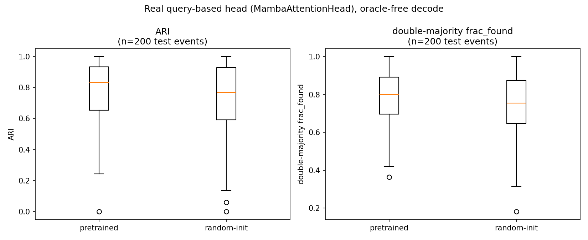
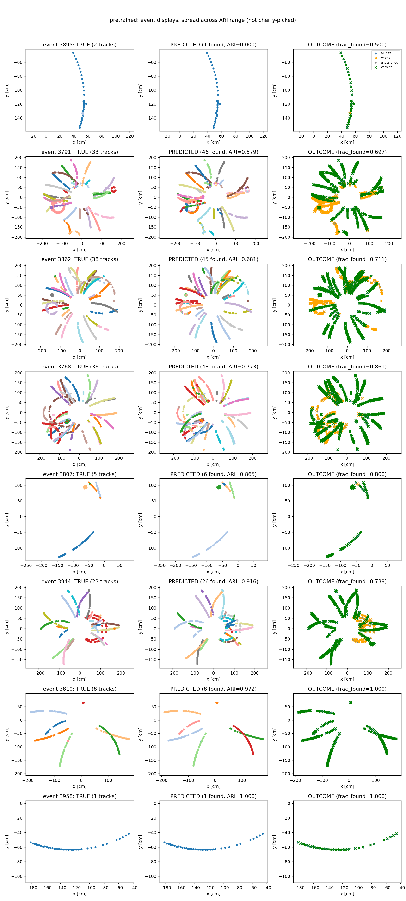
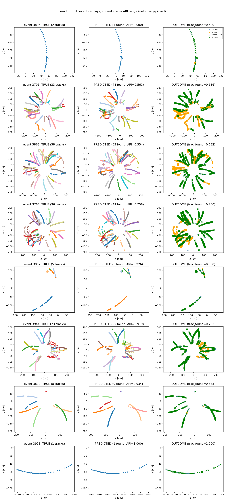
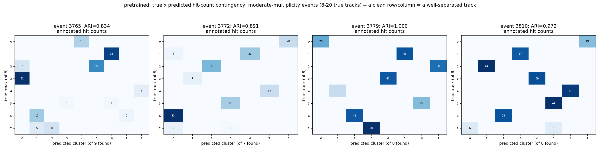
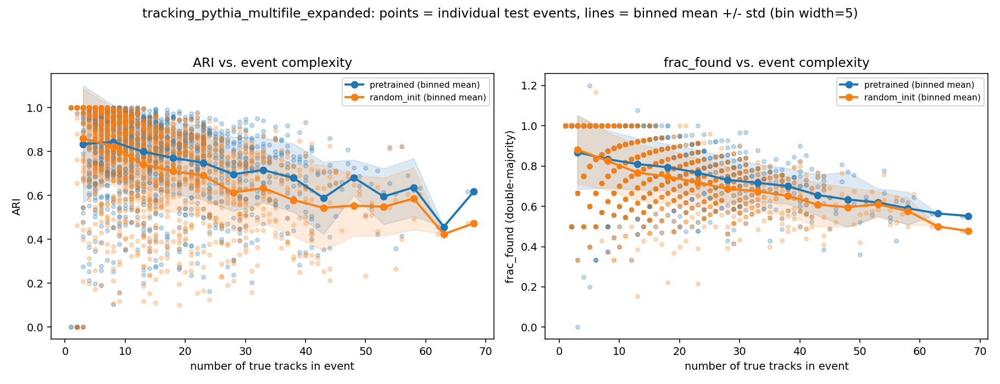
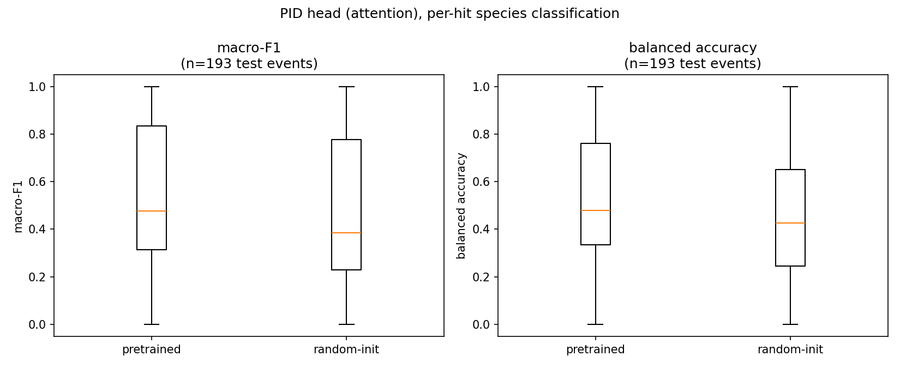
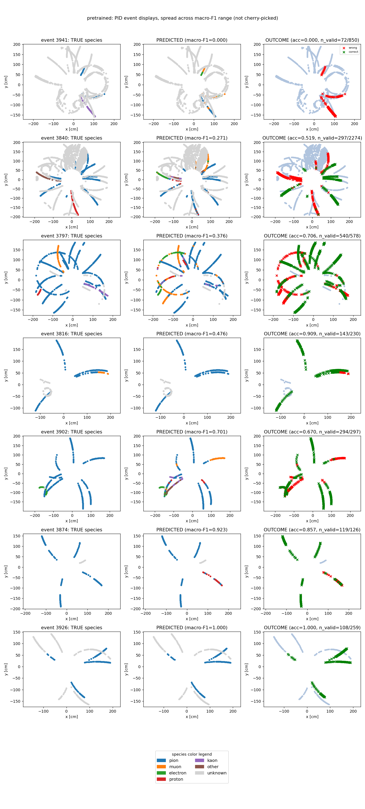
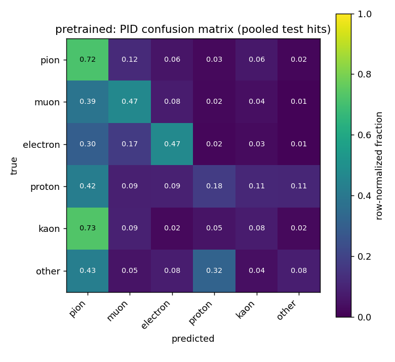
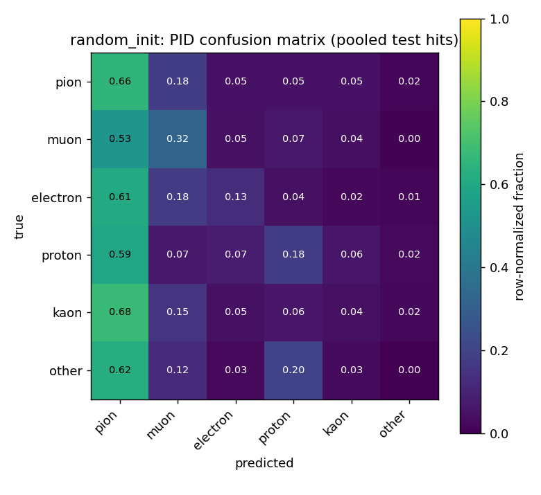

# STAR × FM4NPP: tracking + PID on real multi-track Pythia data (October 12, 2026)

Standalone report on today's work. Short version: found a second, much richer
Pythia MinBias dataset with **real truth particle-species and truth momentum**
(the earlier dataset had neither, despite the schema suggesting otherwise);
built a multi-file conversion pipeline around it; extended the tracking
evaluation with result-persistence and event displays; built a new PID
(particle species classification) evaluation from scratch using FM4NPP's real
`AttentionHead`/`MambaHead` code; replicated the tracking transfer-learning
finding on fully independent data; found the same kind of significant
transfer-learning benefit for PID; and, in the last hour, found a result that
puts a real asterisk on all of today's numbers — swapping the per-hit energy
feature from raw ADC to calibrated charge visibly weakens the measured
transfer-learning signal. That's flagged as the top open item below, not
glossed over.

For the pipeline these build on, see [README_workflow.md](README_workflow.md).
For the STAR-data findings this complements, see
[README_082026.md](README_082026.md) and [README_091626.md](README_091626.md).

## 1. New dataset: real truth PID and truth momentum, verified

`/home/daq/Work/STAR/files/pythia8_pp510_minbias/` — 2000 small ROOT files
(`NNNN.tpchits.root`, ~500 events each, ~665k events total), same generator
and collision energy as an earlier single-file Pythia dataset used a few days
ago, but critically different: that earlier file's `TT` truth tree had
`gePid`/`mcP`/`mcPt`/`mcVr` uniformly `-1`/`-999` (unfilled placeholders,
discovered by checking actual values, not just the schema). This new
production has them genuinely populated — verified across four different
files, not just the first one.

- `T[i]` (0-based) reliably aligns with `TT`'s `evt == i+1` (1-based), with
  full hit-track-id overlap — checked directly, same convention as before.
- ~14% of hits belong to tracks with **no** `TT` record at all (not rare
  species — just unreconstructed). Conflating that with genuinely rare
  species would have been misleading, so it got its own `unknown` class,
  excluded from PID training/eval rather than silently folded into "other."
- Species composition among hit-producing, truth-matched tracks: pion ~41%,
  muon ~7%, electron ~4%, proton ~2%, kaon ~2%, other (pbar/d/t/alpha) ~1%.

## 2. New conversion script: `convert_star_pythia_multifile.py`

Globs the multi-file directory, builds real `pid_target` via the verified
`T<->TT` join (recoded from GEANT3 codes into the 6-class scheme above +
`unknown`), and — as a bonus, since the data was right there — also writes
real `reg_target = (mcP, mcPt, mcEta, mcVr, 0, 0, 0)` per hit, zero-padded to
match the layout `TPCBatchDataset` already expects. Not used by anything yet;
groundwork for a possible future track-*fitting* experiment (see
`README_091626.md`'s discussion of the minGRU trajectory-regression paper),
not needed for today's PID work.

Ran at 8000 events (6400 train / 1600 test, from 17 files) in **3.8 seconds**.

## 3. Tracking: persistence, event displays, and bugs found fixing them

Extended `eval_track_finding_star.py`:

- **Fixed a real OOM.** The first full-scale run on this data crashed (exit
  137) because `collect_features()` held every event's full `(12, N, 512)`
  backbone feature stack in RAM across all 30 epochs — fine for STAR's ~30
  hits/event, but ~41GB at Pythia's ~450 hits/event × 3700 events. Fixed with
  a float16 disk cache instead of an in-RAM list; confirmed identical results
  before/after the fix, confirmed memory stays flat.
- **`--results-dir`**: saves `down_model.pt` (+ `backbone.pt` for the
  random-init arm, since those weights are otherwise unrecoverable),
  `test_results.pkl` per arm (raw hit coords, true labels, predicted
  assignments, per-event metrics), `config.json`, `summary.json`. Verified
  the reload path works cleanly (zero missing/unexpected state-dict keys).
- **`--events-out`**: three-panel (true-colored / predicted-colored /
  outcome-highlighted) spatial event displays, plus a true×predicted
  contingency heatmap.
- **Fixed: independent per-arm event selection.** Originally each arm picked
  its own "worst/median/best" events by its own ARI ranking — since
  pretrained and random-init have different ARI per event, their figures
  almost never showed the same events, defeating side-by-side comparison.
  Now the pretrained arm's picks are reused for random-init.
- **Fixed: illegible contingency heatmap.** First version picked the
  *busiest* events (47-59 simultaneous tracks) — too sparse to render
  legibly in any color scheme. Redesigned to pick moderate-multiplicity
  events (8-20 tracks) with actual hit counts annotated in each cell instead
  of color alone.
- Minor title-overlap layout fix (`tight_layout` wasn't reserving space for
  the figure suptitle).

All of the above fixes were applied and **re-verified entirely from already-saved
`test_results.pkl` files** — no retraining needed for any of them, which was
the whole point of building `--results-dir` in the first place.

### Full-scale tracking result (3700 train / 200 test / 30 epochs)

| metric | pretrained | random-init | delta | Wilcoxon p |
|---|---|---|---|---|
| ARI | 0.773 ± 0.197 | 0.728 ± 0.225 | **+0.045** | **<0.0001** |
| frac_found | 0.790 ± 0.145 | 0.760 ± 0.162 | **+0.030** | **0.0001** |

This closely **replicates** the earlier single-big-file result (+0.045/+0.027
there) on a fully independent dataset — real robustness evidence, not a
repeat of the same data. Runtime: 82m8s.

**Event displays** — same 8 events in both arms (the selection-consistency fix
above), spread across the ARI range from a total failure (event 3895, 2
tracks) to trivial successes, including several genuinely busy 30+ track
events in between:

**Contingency heatmap**, after the busiest-events-are-illegible fix — picking
a moderate-multiplicity band (8-20 tracks) instead, with actual hit counts
annotated per cell. A clean near-diagonal (e.g. event 3779) means the model
cleanly separated every track; visible off-diagonal mass (e.g. event 3765,
row 0/3 both landing partly in predicted cluster 0) is a genuine, readable
confusion, not noise:

### `analyze_ari_vs_tracks.py` + `expand_tracking_eval.py`: more statistics, no retraining

Built a reusable script to plot ARI/frac_found vs. true track count from
saved results. Finding: both metrics degrade steadily with track count (near
ceiling ~0.85-0.9 at 1-5 tracks, down to ~0.4-0.6 at 50+), and **pretrained
sits above random-init across nearly the whole range**, not just on average —
strongest in the 15-45 track band, converging only at the easy (1-5 track)
extreme where the task is trivial for both.

To get tighter statistics (the original 200-test-event bins were noisy above
~30 tracks), built `expand_tracking_eval.py`: reloads the already-saved
`down_model.pt`/`backbone.pt`, no retraining, and scores the dataset's
**1600-event "test" split** — never touched during training, since training
only ever reads from the "train" split. Ran in **1m20s** (vs. 82 minutes for
the original training) for 3080 forward passes. Result: pretrained ARI
0.789±0.193 vs. random-init 0.750±0.208 (n=1540) — consistent with, slightly
higher than, the original 200-event number. Extended the track-count range
observed to 67.

One minor quirk surfaced by the extra statistics, not a bug: a few
`frac_found` values slightly exceed 1.0. The double-majority scoring can
double-count a true track if it gets split into exactly two predicted
clusters that both independently clear the `efficiency >= 0.5` threshold on
an exact 50/50 hit split. This logic has been unchanged since
`evaluate_tracking.py`; it just wasn't visible before at low statistics.

## 4. PID: new evaluation built from scratch, significant result

`eval_pid_star.py` mirrors the tracking script's structure and
persistence/display pattern, but uses FM4NPP's *other* real downstream head —
`model.py`'s `AttentionHead`/`MambaHead` (used by
`point_classification_trainer.py`) — a much simpler per-point classifier than
tracking's `MambaAttentionHead`: no Hungarian matching, no query prototypes,
just per-hit class logits off the same frozen-backbone layer-weighted-average
input convention. Masked cross-entropy excludes `unknown`-class hits from
both loss and metrics; class-weighted by default given the pion-dominated
imbalance.

Caught and fixed one real bug during the smoke test (missing `device` arg in
a `score_event()` call). A second smoke-test finding wasn't a bug: at 15
events/2 epochs, the head collapsed to predicting "pion" for literally every
hit in both arms (confirmed via direct prediction-array comparison) — an
expected under-training artifact given the severe class imbalance at that
tiny scale, not a code problem.

### Full-scale PID result (n=193 valid test events)

| metric | pretrained | random-init | delta | Wilcoxon p |
|---|---|---|---|---|
| macro-F1 | 0.552 ± 0.282 | 0.487 ± 0.314 | **+0.064** | **<0.0001** |
| balanced accuracy | 0.535 ± 0.259 | 0.482 ± 0.293 | **+0.053** | **0.0005** |
| accuracy | 0.640 ± 0.226 | 0.580 ± 0.277 | **+0.059** | **0.0020** |

All three significant — pretraining transfers to a genuinely different
downstream task (species classification, not hit-to-track assignment).
Runtime: 49m52s (faster than tracking, despite `AttentionHead`'s self-attention
being O(N²) over the full hit sequence — up to ~2000 hits here — vs.
tracking's linear-time Mamba2 backbone; a real architectural cost difference
worth remembering if PID is ever scaled to busier data).

**Event displays, pretrained backbone only** — 7 events spread across the
full macro-F1 range (0.000 to 1.000, not cherry-picked), true species /
predicted species / correct-vs-wrong outcome side by side, with a dedicated
color-legend panel at the bottom. Gray dots are `unknown`-class hits (no
truth match, excluded from training and scoring) — most hits in any event
are gray, which is the ~42.5% unknown fraction from section 1 made visible;
most of the labeled (colored) hits are pion (blue), matching the ~41%
pion-dominance of the known-species sample:

**Confusion matrices** (pooled test hits, row-normalized) — the clearest single
view of what the model actually gets wrong, read off the images directly
rather than asserted: pretrained's true-class recall beats random-init's on
muon (0.47 vs. 0.32) and especially electron (0.47 vs. **0.13**); the two
are exactly tied on proton (0.18 each); kaon and "other" are both weak for
both arms (<=0.08 pretrained, <=0.04 random-init). Most (not all — kaon is an
exception) rows show random-init misclassifying more often as "pion" than
pretrained does, e.g. electron->pion is 0.61 for random-init vs. 0.30 for
pretrained:

One pattern worth noting: random-init reached a **lower** final training loss
(0.256 vs. pretrained's 0.459) yet generalized **worse** (lower test
macro-F1) — consistent with, though not proof of, random-init overfitting
more readily without the pretrained backbone's more structured features.

**Caveat not yet resolved:** per-event macro-F1 uses `labels=present` (only
classes actually true in that event) rather than the full 6-class set, which
is more lenient than a strict macro average — visible as the repeated
"y_pred contains classes not in y_true" sklearn warnings in the run log. A
stricter recompute is possible from the already-saved predictions without
retraining; not yet done.

PID event displays got the same same-events-across-arms fix as tracking, plus
a redesign: the 8th event-display row is now a dedicated color-legend panel
(species -> color) instead of a cramped bottom strip, trading one event row
for actual legibility.

## 5. Open item found last: the E-feature (ADC vs. calibrated charge) question

Prompted by a direct question about whether STAR's ADC variation differs from
sPHENIX's. Checked real distributions rather than assume:

| | mean | std | CV | skew |
|---|---|---|---|---|
| sPHENIX (`SPHENIX_STATS`, hardcoded) | 253 | 269 | 1.06 | — (no raw data) |
| STAR `TPCHits_adc` (this Pythia sample) | 434 | 834 | 1.92 | 9.6 |
| STAR `TPCHits_q` (calibrated charge) | 12.0 | 19.6 | 1.64 | 6.9 |

`--norm star` (used throughout every run so far) already recomputes
STAR-specific mean/std, correcting raw *scale* differences. It does **not**
correct *shape* — STAR's ADC distribution is far more heavy-tailed/skewed
(skew 9.6) than sPHENIX's apparently more moderate one, meaning a meaningful
fraction of STAR hits land at extreme standardized-E values the pretrained
embedder never saw anything comparable to during sPHENIX pretraining.

Ran a matched-scale ablation (300 train / 100 test / 15 epochs, seed 42, same
events, only `--e-branch` changed):

| E feature | ARI delta | ARI p | frac_found delta | frac_found p |
|---|---|---|---|---|
| `TPCHits_adc` (default, used everywhere above) | +0.070 | <0.0001 | +0.095 | <0.0001 |
| `TPCHits_q` (calibrated charge) | +0.014 | 0.0105 | **−0.007** | **0.770 (not significant)** |

**Switching to calibrated charge substantially weakens, and for frac_found
erases, the measured transfer-learning signal.** This is one quick check —
single seed, reduced scale, not yet run on PID or at full scale — but it's a
real finding that puts a caveat on every result in sections 3-4 above, all of
which used the default ADC feature. Framing this precisely: this does not
mean the transfer-learning effect is fake — it means the *size* of the
measured effect depends on a feature choice that hasn't been otherwise
examined, and that dependency itself needs understanding (is ADC's heavy tail
giving the pretrained model a genuine-but-ADC-specific shortcut, or is
calibrated charge just a less informative feature for both arms regardless of
transfer?). Not yet known.

## Plans / to-do, in rough priority order

1. **Chase the E-feature finding** — the most important open item. Needs: a
   multi-seed check at the ablation's current scale (single seed isn't
   enough to trust, per this project's own standing rule); then, if it
   holds up, a full-scale (3700/200/30) run with `TPCHits_q` for both
   tracking and PID; then some attempt to understand *why* (not just *that*)
   the feature choice matters this much.
2. Depending on (1)'s outcome, consider implementing a `log1p`-style
   transform on E before z-scoring, to address the heavy-tail shape
   difference directly rather than picking between two raw quantities that
   are both skewed relative to sPHENIX. Touches `event_polar()`, shared by
   every script in this project — needs discussion before changing, since it
   would shift every previously-reported number.
3. Multi-seed check for today's tracking and PID results on the new
   multi-file dataset — both are currently single-seed, same caveat flagged
   (and resolved) for the STAR silhouette work months ago, not yet applied
   here.
4. Recompute PID macro-F1 with the stricter full-6-class `labels` set
   (quick, from already-saved predictions, no retraining).
5. The now-real `reg_target` (truth momentum/vertex) `convert_star_pythia_multifile.py`
   writes is currently unused by anything — revisit the track-*fitting*
   idea from the minGRU-paper discussion in `README_091626.md` if there's
   appetite for a third downstream task.
6. Minor: the `frac_found` double-majority tie-counting edge case (section 3)
   — low priority, rare, doesn't change conclusions, but a real known quirk
   worth fixing eventually rather than leaving as a surprise in future plots.
7. If PID is ever scaled up further, reconsider `AttentionHead`'s O(N²)
   self-attention cost on busy (1000+ hit) events — `MambaHead` (linear-time,
   same file) is the lighter alternative already available, untested so far.

## See also

- [README_workflow.md](README_workflow.md) — full pipeline walkthrough.
- [README_091626.md](README_091626.md) — the real-adapter tracking work this
  builds on, including the minGRU trajectory-fitting paper discussion.
- [README_082026.md](README_082026.md) — the original STAR embedding-level
  (silhouette) result and multi-seed-robustness methodology this project's
  statistical discipline is built on.
