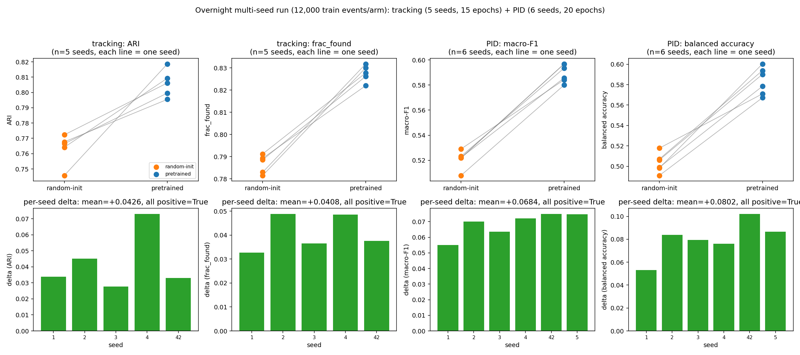
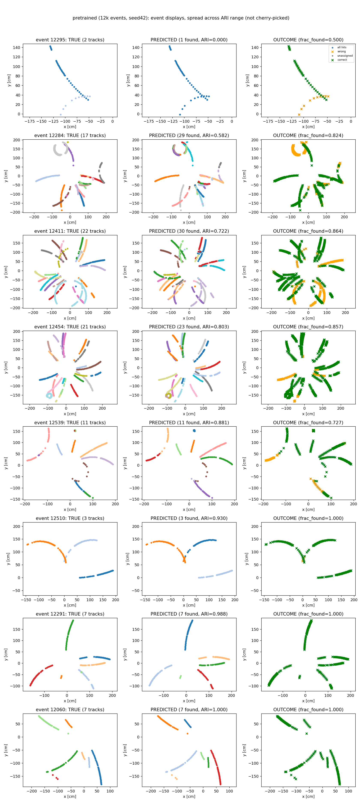
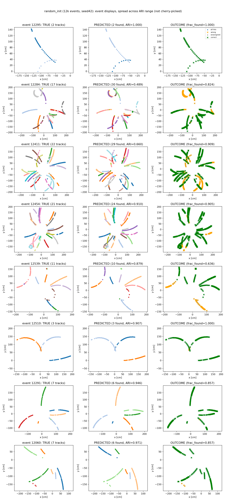
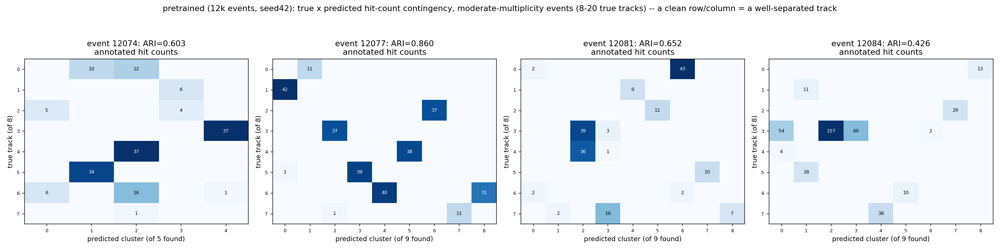
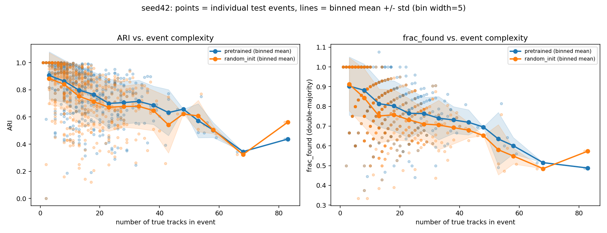
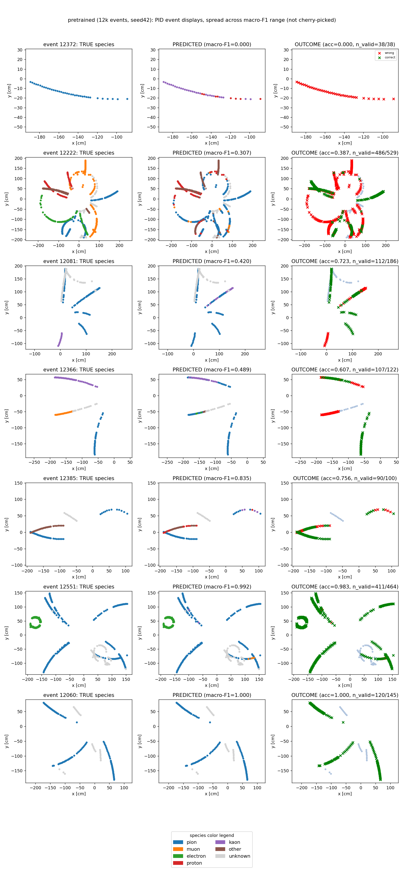
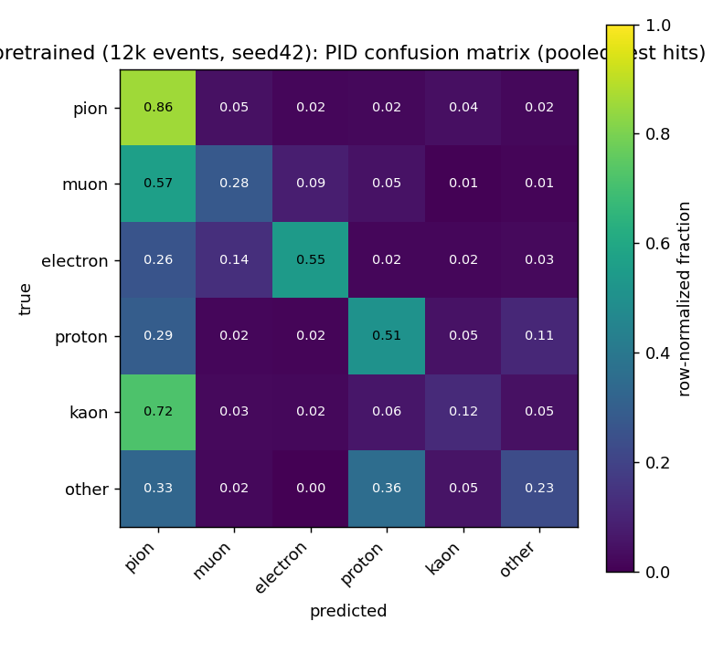
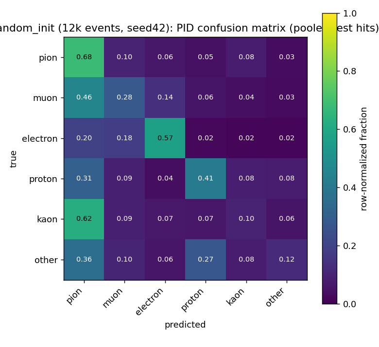

# STAR × FM4NPP: tracking + PID on real multi-track Pythia data (October 12-14, 2026)

Standalone report spanning three days of connected work. Short version: found
a second, much richer Pythia MinBias dataset with **real truth
particle-species and truth momentum** (the earlier dataset had neither,
despite the schema suggesting otherwise); built a multi-file conversion
pipeline around it; built two downstream evaluations from scratch — tracking
(reusing FM4NPP's real `MambaAttentionHead`) and PID (reusing FM4NPP's real
`AttentionHead`/`MambaHead`) — each showing a significant pretrained-vs.
random-init transfer-learning benefit; then, overnight, **multi-seed
confirmed both results at 3.2x the training data** (5 tracking seeds, 6 PID
seeds, every single one positive). The one open asterisk that survives all of
this: swapping the per-hit energy feature from raw ADC to calibrated charge
visibly weakens the measured signal in a quick single-seed check — flagged
as the top remaining open item, not glossed over, and **not yet re-tested
under the new multi-seed/larger-scale methodology**.

For the pipeline these build on, see [README_workflow.md](README_workflow.md).
For the STAR-data findings this complements, see
[README_082026.md](README_082026.md) and [README_091626.md](README_091626.md).

## 1. New dataset: real truth PID and truth momentum, verified

`/home/daq/Work/STAR/files/pythia8_pp510_minbias/` — 2000 small ROOT files
(`NNNN.tpchits.root`, ~500 events each, ~1M events total), same generator and
collision energy as an earlier single-file Pythia dataset used a few days
prior, but critically different: that earlier file's `TT` truth tree had
`gePid`/`mcP`/`mcPt`/`mcVr` uniformly `-1`/`-999` (unfilled placeholders,
discovered by checking actual values, not just the schema). This new
production has them genuinely populated — verified across several different
files, not just the first one.

- `T[i]` (0-based) reliably aligns with `TT`'s `evt == i+1` (1-based), with
  full hit-track-id overlap — checked directly.
- ~14-43% of hits (varies by sample size/selection, see below) belong to
  tracks with **no** `TT` record at all — not rare species, just
  unreconstructed. STAR's real tracking/reconstruction chain doesn't recover
  every particle, especially in busy events (`TT`'s own columns — `nFit`,
  `nPoss`, `dca`, `tofMatch` — are standard reconstruction-quality variables,
  confirming it's a *reconstructed*-track table, not a raw truth-particle
  list). Conflating unreconstructed hits with genuinely rare species would
  be misleading, so they got their own `unknown` class, excluded from PID
  training/eval. Checked directly: `IdTruth` is never the "no generating
  particle" sentinel (0) in this production — every hit does come from a
  real simulated particle, the gap is purely about reconstruction, not
  missing truth.
- Species composition among hit-producing, truth-matched tracks: pion ~41%,
  muon ~7%, electron ~4%, proton ~2%, kaon ~2%, other (pbar/d/t/alpha) ~1%.

## 2. Conversion script: `convert_star_pythia_multifile.py`

Globs the multi-file directory, builds real `pid_target` via the verified
`T<->TT` join (recoded from GEANT3 codes into the 6-class scheme above +
`unknown`), and — as a bonus, since the data was right there — also writes
real `reg_target = (mcP, mcPt, mcEta, mcVr, 0, 0, 0)` per hit, zero-padded to
match the layout `TPCBatchDataset` already expects. Not used by anything yet;
groundwork for a possible future track-*fitting* experiment (see
`README_091626.md`'s discussion of the minGRU trajectory-regression paper).

Used twice at increasing scale: 8,000 events (6,400 train / 1,600 test, 17
files) for the initial single-seed checks in sections 3-5, then 16,000 events
(15,200 train / 800 test, ~35 files) for the overnight multi-seed run in
section 6 — both well under a minute to convert.

## 3. Tracking

Built `eval_track_finding_star.py` — reuses FM4NPP's real
`MambaAttentionHead` (the paper's DETR/Mask2Former-style set predictor: no
oracle track count, learned query prototypes, `PointHungarianMatcher` +
Dice/focal/classification losses) with a frozen backbone, comparing
pretrained vs. random-init. Along the way:

- **Fixed a real OOM.** The first full-scale run crashed (exit 137) because
  `collect_features()` held every event's full `(12, N, 512)` backbone
  feature stack in RAM across all epochs — fine for STAR's ~30 hits/event,
  but ~41GB at Pythia's ~450 hits/event × thousands of events. Fixed with a
  float16 disk cache instead of an in-RAM list; confirmed identical results
  before/after the fix.
- **`--results-dir`**: saves `down_model.pt` (+ `backbone.pt` for the
  random-init arm, otherwise unrecoverable), `test_results.pkl` per arm (raw
  hit coords, true labels, predicted assignments, per-event metrics),
  `config.json`, `summary.json` — verified the reload path works cleanly
  (zero missing/unexpected state-dict keys), and every plotting fix below was
  applied and re-verified **entirely from already-saved results, no
  retraining needed**.
- **`--events-out`**: three-panel (true-colored / predicted-colored /
  outcome-highlighted) event displays, plus a true×predicted contingency
  heatmap — after two real design fixes: (1) pretrained and random-init
  originally picked their "worst/median/best" events independently by each
  arm's own ARI ranking, almost never showing the same events — fixed by
  reusing pretrained's picks for random-init; (2) the contingency heatmap
  originally picked the *busiest* events (47+ simultaneous tracks), too
  sparse to render legibly in any color scheme — redesigned to pick a
  moderate-multiplicity band (8-20 tracks) with actual hit counts annotated
  per cell instead of color alone.

### Current best result: multi-seed, 3.2x the data (see section 6 methodology)

| metric | pretrained | random-init | mean delta (std across seeds) | seeds positive |
|---|---|---|---|---|
| ARI (5 seeds) | 0.806 ± 0.008 | 0.763 ± 0.009 | **+0.043** (0.016) | **5/5** |
| frac_found (5 seeds) | 0.828 ± 0.003 | 0.787 ± 0.004 | **+0.041** (0.007) | **5/5** |

12,000 train / 500 test events per run, 15 epochs, seeds 42/1/2/3/4. Five
seeds is one short of this project's own n>=6 threshold for a formal
significance test (see `README_082026.md`), so reported descriptively rather
than with a p-value — but 5/5 seeds landing the same direction, with a
seed-to-seed std almost 3x smaller than the per-seed deltas themselves, is
real consistency evidence on its own.

**Earlier, lower-statistics check (single seed, 3,700 train events) — same
conclusion, kept for reference, not a separate finding:** ARI 0.773 ± 0.197
vs. 0.728 ± 0.225 (delta +0.045, Wilcoxon p<0.0001 *within that one run's 200
test events*); frac_found 0.790 ± 0.145 vs. 0.760 ± 0.162 (delta +0.030,
p=0.0001). This number is what first suggested the effect, closely matching
what the full multi-seed run later confirmed (+0.045→+0.043) — the
multi-seed result above supersedes it as the thing to trust, this is kept
only to show the two agree.

**Event displays** (seed 42, 12,000-event scale — same 8 events in both
arms, spread across the ARI range, not cherry-picked):

**Contingency heatmap** (moderate-multiplicity band, 8-20 tracks, hit counts
annotated per cell) — a clean near-diagonal means the model cleanly
separated every track; visible off-diagonal mass is a genuine, readable
confusion, not noise:

**ARI/frac_found vs. track count** (seed 42, 500 test events, track-count
range now extends to 82): both metrics degrade steadily with event
complexity (near ceiling at 1-5 tracks, down to ~0.4-0.6 at 50+), and
pretrained sits above random-init across nearly the whole range — consistent
with the same analysis at the smaller scale, now reproduced independently
at 12k events:

One minor quirk, not a bug: a few `frac_found` values slightly exceed 1.0 —
the double-majority scoring can double-count a true track if it gets split
into exactly two predicted clusters that both independently clear the
`efficiency >= 0.5` threshold on an exact 50/50 hit split. Unchanged since
`evaluate_tracking.py`; just wasn't visible before at low statistics.

## 4. PID (particle species classification)

Built `eval_pid_star.py` — mirrors the tracking script's structure and
persistence/display pattern, but uses FM4NPP's *other* real downstream head,
`model.py`'s `AttentionHead`/`MambaHead` (used by
`point_classification_trainer.py`): a much simpler per-point classifier than
tracking's `MambaAttentionHead` — no Hungarian matching, no query
prototypes, just per-hit class logits off the same frozen-backbone
layer-weighted-average input convention. Masked cross-entropy excludes
`unknown`-class hits from both loss and metrics (the classifier head has only
6 output classes — it has no "unknown" option at all); class-weighted by
default given the pion-dominated imbalance.

Caught and fixed one real bug during the initial smoke test (missing
`device` arg in a `score_event()` call). A second smoke-test finding wasn't a
bug: at 15 events/2 epochs, the head collapsed to predicting "pion" for
literally every hit in both arms (confirmed via direct prediction-array
comparison) — an expected under-training artifact at that tiny scale, not a
code problem.

**Only reconstructed-track hits are used for training/eval** (see section
1) — but the model still sees and processes the *entire* hit sequence,
reconstructed or not, when forming its predictions; the `unknown`-class
exclusion only applies to the loss and the scoring, not to what the model is
allowed to look at.

### Current best result: multi-seed, 3.2x the data (see section 6 methodology)

| metric | pretrained | random-init | mean delta (std across seeds) | seeds positive | seed-level Wilcoxon p |
|---|---|---|---|---|---|
| macro-F1 (6 seeds) | 0.590 ± 0.007 | 0.521 ± 0.006 | **+0.068** (0.007) | **6/6** | **0.0312** |
| balanced accuracy (6 seeds) | 0.584 ± 0.012 | 0.503 ± 0.008 | **+0.080** (0.015) | **6/6** | **0.0312** |

12,000 train / 500 test events per run, 20 epochs, seeds 42/1/2/3/4/5 — six
seeds is enough for this project's own significance-test threshold, and it
clears it. This is the first result in this whole Pythia-data effort to
reach formal seed-level significance, not just per-event significance within
one run.

**Earlier, lower-statistics check (single seed, 3,700 train events, n=193
valid test events) — same conclusion, kept for reference:** macro-F1
0.552 ± 0.282 vs. 0.487 ± 0.314 (delta +0.064, p<0.0001 within-run);
balanced accuracy 0.535 ± 0.259 vs. 0.482 ± 0.293 (delta +0.053, p=0.0005);
accuracy 0.640 ± 0.226 vs. 0.580 ± 0.277 (delta +0.059, p=0.0020). Again,
closely matches what the multi-seed run later confirmed (macro-F1
+0.064→+0.068) — reference only, superseded by the table above.

**Event displays, pretrained backbone only** (seed 42, 12k-event scale) — 8
events spread across the full macro-F1 range, true species / predicted
species / correct-vs-wrong outcome side by side, with a dedicated
color-legend panel. Gray dots are `unknown`-class hits (no truth match,
excluded from training/scoring) — correlates strongly with event busyness,
not randomly distributed: the two grayest events in any such set are
reliably among the busiest (confirmed directly in the 10/12 single-seed
version: an event with 53 simultaneous tracks had only 13% known-species
hits, vs. 99% for a 10-track event):

**Confusion matrices** (pooled test hits, row-normalized, seed 42, 12k-event
scale) — read directly off the images, not asserted: pretrained's true-class
recall clearly beats random-init's on pion (0.86 vs. 0.68), proton (0.51 vs.
0.41), and "other" (0.23 vs. 0.12); the two are close on kaon (0.12 vs. 0.10)
and muon (tied at 0.28); **electron is essentially tied or slightly reversed
at this scale/seed (0.55 vs. 0.57)** — a genuinely different per-class
pattern than the earlier 3,700-event single-seed check, where electron had
been the single largest gap (0.47 vs. 0.13). Worth being precise about this:
the **aggregate** effect (macro-F1, balanced accuracy) is robust across both
scales and all 6 seeds — *which specific classes* drive it is not
necessarily stable, and shouldn't be over-interpreted from one
confusion-matrix snapshot:

One pattern worth noting from the earlier single-seed run: random-init
reached a **lower** final training loss (0.256 vs. pretrained's 0.459) yet
generalized **worse** (lower test macro-F1) — consistent with, though not
proof of, random-init overfitting more readily without the pretrained
backbone's more structured features.

**Caveat not yet resolved:** per-event macro-F1 uses `labels=present` (only
classes actually true in that event) rather than the full 6-class set, more
lenient than a strict macro average (visible as repeated "y_pred contains
classes not in y_true" sklearn warnings in the run logs). A stricter
recompute is possible from already-saved predictions without retraining; not
yet done, for either scale.

## 5. Open item: the E-feature (ADC vs. calibrated charge) question — still untested at the new scale

Prompted by a direct question about whether STAR's ADC variation differs from
sPHENIX's. Checked real distributions rather than assume:

| | mean | std | CV | skew |
|---|---|---|---|---|
| sPHENIX (`SPHENIX_STATS`, hardcoded) | 253 | 269 | 1.06 | — (no raw data) |
| STAR `TPCHits_adc` (this Pythia sample) | 434 | 834 | 1.92 | 9.6 |
| STAR `TPCHits_q` (calibrated charge) | 12.0 | 19.6 | 1.64 | 6.9 |

`--norm star` (used throughout every run in this file) already recomputes
STAR-specific mean/std, correcting raw *scale* differences. It does **not**
correct *shape* — STAR's ADC distribution is far more heavy-tailed/skewed
than sPHENIX's apparently more moderate one, meaning a meaningful fraction of
STAR hits land at extreme standardized-E values the pretrained embedder
never saw anything comparable to during sPHENIX pretraining.

Ran a matched-scale ablation (300 train / 100 test / 15 epochs, single seed
42, same events, only `--e-branch` changed):

| E feature | ARI delta | ARI p | frac_found delta | frac_found p |
|---|---|---|---|---|
| `TPCHits_adc` (default, used everywhere above) | +0.070 | <0.0001 | +0.095 | <0.0001 |
| `TPCHits_q` (calibrated charge) | +0.014 | 0.0105 | **−0.007** | **0.770 (not significant)** |

**Switching to calibrated charge substantially weakens, and for frac_found
erases, the measured transfer-learning signal.** Single seed, reduced scale,
and — importantly — predates both the multi-seed run and the 12k-event
scale-up in sections 3-4. It's not yet known whether this weakening survives
either of those upgrades, which is exactly why it remains the top open item:
section 6 proves the ADC-based effect is robust to seed and scale; it says
nothing about whether the same robustness would hold under calibrated
charge. Framing this precisely: this does not mean the transfer-learning
effect is fake — it means the *size* of the measured effect depends on a
feature choice that hasn't been tested under the same rigor as everything
else in this file yet.

## 6. Methodology: the overnight multi-seed run (October 13-14)

The numbers in sections 3 and 4 above came from a single 24h13m background
job: converted 16,000 events (section 2), then trained 5 tracking seeds (42,
1, 2, 3, 4 — 12,000 train events, 15 epochs each) followed by 6 PID seeds
(42, 1, 2, 3, 4, 5 — 12,000 train events, 20 epochs each), sequentially, not
in parallel.

**Epoch counts were chosen from the actual loss curves of the single-seed
10/12 runs, not guessed:** tracking's loss had largely flattened by epoch
15-20 (only ~5% further drop from epoch 18 to 29 of the earlier run) — more
epochs would have bought little, so the time budget went to more unique
events instead. PID's loss was still dropping ~35% from epoch 20 to 29, not
plateaued — worth the extra epochs even at the cost of fewer seeds fitting
in the same wall-clock budget.

Two things went wrong on the way to launching this cleanly, both caught and
fixed before causing real damage:

1. **A naive compute-only time estimate was wrong.** Extrapolating straight
   from measured seconds/training-step suggested ~65k-107k events/arm would
   fit in 24h. The actual binding constraint turned out to be **disk
   space** for the float16 feature cache (~5.65MB/event), not GPU time: only
   ~100GB was free, capping any single run at ~17-20k events — far below the
   compute-only estimate. This is why sections 3-4 use 12,000 events, not
   the much larger number a pure-throughput calculation would have
   suggested, and it's an open scaling bottleneck (to-do list, below).
2. **A manual `nohup ... &` launch** (used to route around a tool timeout)
   left an orphaned process running after an attempted cleanup, which
   briefly raced against a fresh, properly-backgrounded relaunch about to
   overwrite the same dataset directory. Caught via a direct process check
   before either run produced bad output; both killed, dataset directory
   wiped and reconverted clean before the real run started. No corrupted
   results made it into sections 3-4.

## Plans / to-do, in rough priority order

1. **Chase the E-feature finding (section 5)** — the most important open
   item, more interesting now that the ADC-based effect is confirmed robust
   to seed and scale (section 6). Needs: a multi-seed check with
   `TPCHits_q` at the same 12k-event scale; then some attempt to understand
   *why* (not just *that*) the feature choice matters this much.
2. Depending on (1)'s outcome, consider a `log1p`-style transform on E
   before z-scoring, addressing the heavy-tail shape difference directly
   rather than picking between two raw quantities both skewed relative to
   sPHENIX. Touches `event_polar()`, shared by every script in this
   project — needs discussion before changing, since it would shift every
   previously-reported number.
3. Recompute PID macro-F1 with the stricter full-6-class `labels` set
   (quick, from already-saved predictions, no retraining needed, for either
   the 3,700- or 12,000-event results).
4. The disk-space ceiling found in section 6 (~17-20k events/run at current
   free space) will keep capping further scale-up until addressed — either
   by freeing space, or by changing the feature-caching strategy (e.g.
   regenerating per-epoch instead of caching the whole train set, trading
   compute time for disk — the opposite tradeoff from section 3's original
   OOM fix, worth revisiting now that disk, not RAM, is the limiter).
5. The now-real `reg_target` (truth momentum/vertex) is currently unused by
   anything — revisit the track-*fitting* idea from the minGRU-paper
   discussion in `README_091626.md` if there's appetite for a third
   downstream task.
6. Minor: the `frac_found` double-majority tie-counting edge case (section
   3) — low priority, rare, doesn't change conclusions.
7. If PID is ever scaled up further, reconsider `AttentionHead`'s O(N²)
   self-attention cost on busy (1000+ hit) events — `MambaHead`
   (linear-time, same file) is the lighter alternative already available,
   untested so far.

## See also

- [README_workflow.md](README_workflow.md) — full pipeline walkthrough.
- [README_091626.md](README_091626.md) — the real-adapter tracking work this
  builds on, including the minGRU trajectory-fitting paper discussion.
- [README_082026.md](README_082026.md) — the original STAR embedding-level
  (silhouette) result and multi-seed-robustness methodology this project's
  statistical discipline is built on.
