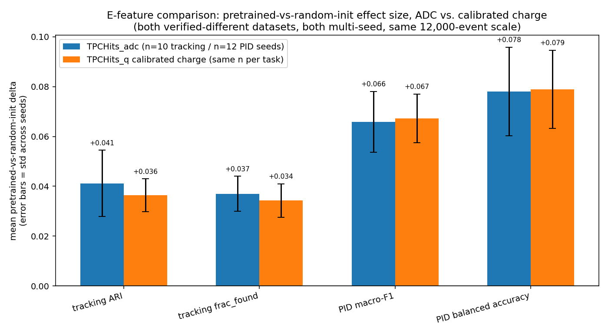
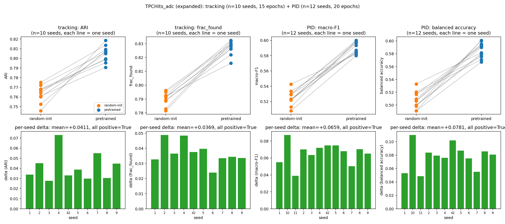
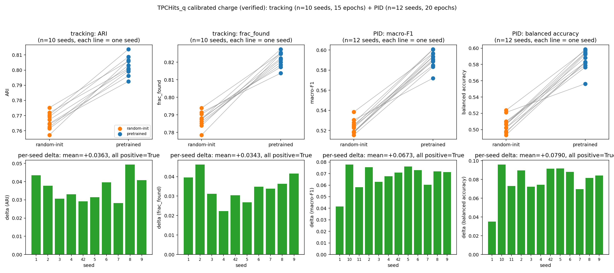
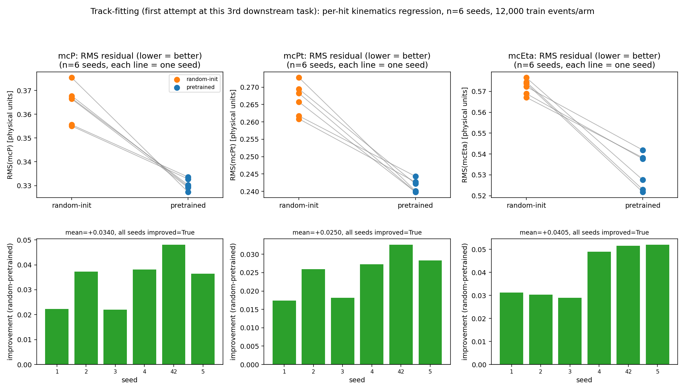

# STAR × FM4NPP: the E-feature question resolved, plus track-fitting (October 21, 2026)

Standalone report closing out the thread `README_Oct12_2026.md` left open: is
the pretrained-vs-random-init transfer-learning effect specific to using raw
ADC as the per-hit energy feature, or does it hold under calibrated charge
too? Short answer, now properly verified: **it barely matters — ADC and
calibrated charge give essentially the same effect size, for both tracking
and PID, across 10-12 seeds each.** The single-seed result that originally
raised the alarm doesn't hold up at proper scale. Getting to that answer took
two attempts: the first one accidentally re-tested ADC against itself due to
a scripting mistake (full account below, not glossed over), costing about
45 hours of compute before being caught. The second attempt was built with a
hard verification gate specifically to prevent a repeat, and gave the result
above. Along the way, a new third downstream task (track-fitting, regressing
real truth momentum/direction) also got its first-ever test, with a clean
significant result.

For the methodology and dataset this builds on, see
[README_Oct12_2026.md](README_Oct12_2026.md). For the pipeline, see
[README_workflow.md](README_workflow.md).

## 1. What was attempted, and what went wrong

The plan (agreed Friday): spend the weekend's ~58 free hours on the single
most important open item from `README_Oct12_2026.md` — re-run the
ADC-vs-calibrated-charge ablation under this project's actual rigor (multi-seed,
12,000 events), not the single-seed/300-event check that first flagged it.
Budget: 10 tracking seeds + 12 PID seeds with `TPCHits_q`, plus — since the
weekend had room — 6 seeds of a brand new third downstream task
(track-fitting) using the real truth-momentum `reg_target`
`convert_star_pythia_multifile.py` had been writing unused since section 2
of the previous report.

**What actually happened:** a cleanup command run just before launch —
`sed -i '/--e-branch TPCHits_q \\$/d' script.sh`, intended to strip
`--e-branch TPCHits_q` only from the `eval_track_finding_star.py` calls
(which correctly don't accept that flag — it only applies at conversion
time) — matched and deleted *every* line with that exact text in the file,
including the one line that needed to survive: the actual data **conversion**
command. The conversion silently fell back to its own argparse default
(`TPCHits_adc`), so `data/pythia510_multifile_16k_qcharge` was built from raw
ADC, identical to the existing dataset. Confirmed directly: the two
datasets' per-hit E values matched to the last decimal, event by event,
because `--seed` also defaulted to 42 in both conversions, making even the
train/test shuffle identical. The ~45 hours of tracking+PID compute that
followed was a bit-for-bit-reproducible rerun of the ADC experiment, not a
test of anything new.

**The fix:** rewrote the launch script from scratch rather than patching the
old one, and added a hard verification step immediately after conversion —
compares E values between the new dataset and the ADC reference for 20
events, and `raise SystemExit`s *before* any training starts if they match.
Relaunched; the gate printed `[VERIFIED OK]` with genuinely different E
values this time, and the run proceeded correctly through all 22 seeds with
zero errors.

## 2. The E-feature question, now properly answered

| metric | ADC delta (n=10/12 seeds) | charge delta (n=10/12 seeds) |
|---|---|---|
| Tracking ARI | +0.041 ± 0.013 | +0.036 ± 0.007 |
| Tracking frac_found | +0.037 ± 0.007 | +0.034 ± 0.007 |
| PID macro-F1 | +0.066 ± 0.012 | **+0.067 ± 0.010** |
| PID balanced accuracy | +0.078 ± 0.018 | **+0.079 ± 0.016** |

PID is essentially an exact match between the two features. Tracking shows a
small gap (charge slightly lower) but well within the seed-to-seed spread —
nothing like the near-total collapse the single-seed ablation suggested.

**This reverses the earlier finding, not just softens it.** The original
check (300 train events, single seed 42) found charge's `frac_found` delta
was not even statistically significant (p=0.770) against ADC's clearly
significant one (p<0.0001). At proper scale, both features give significant,
consistent, same-direction effects for every metric in both tasks. The
original result was a small-sample artifact — exactly the failure mode this
project's "always multi-seed-check before trusting a single run" rule exists
to catch, now demonstrated on itself in the other direction (a worrying
result disappearing under scrutiny, not just a promising one holding up).

**Full per-seed detail**, for completeness:

## 3. Bonus: the failed run still expanded the ADC multi-seed evidence

The accidental ADC-vs-ADC rerun wasn't a total loss — it used 5 new tracking
seeds (5,6,7,8,9) and 6 new PID seeds (6,7,8,9,10,11) beyond
`README_Oct12_2026.md`'s original 5/6, all genuinely new random
initializations even though the underlying data wasn't what was intended.
Combined with the originals:

| metric | n seeds (was) | pretrained | random-init | mean delta | Wilcoxon p |
|---|---|---|---|---|---|
| Tracking ARI | **10** (was 5) | 0.805 ± 0.008 | 0.763 ± 0.009 | +0.041 | **0.0020** |
| PID macro-F1 | **12** (was 6) | 0.591 ± 0.007 | 0.525 ± 0.009 | +0.066 | **0.0005** |

Tracking crosses this project's own n>=6 significance threshold for the
first time (previously reported descriptively only, 5 seeds). Both results
are consistent with, and now more precisely pinned down than, the numbers in
`README_Oct12_2026.md` section 6.

## 4. Track-fitting: first-ever result for a new third downstream task

Unaffected by the bug (it used the regular ADC dataset throughout, and
doesn't touch `--e-branch` at all). `eval_trackfit_star.py` mirrors
`eval_pid_star.py`'s structure exactly, but regresses continuous truth
kinematics — mcP, mcPt, mcEta — instead of classifying species, using the
real `reg_target` written by `convert_star_pythia_multifile.py` and left
unused until now. Frozen backbone, `AttentionHead` with 3 regression outputs
instead of 6 classification logits, masked Huber loss, metric is plain RMS
residual in physical units (not yet the iteratively-3σ-clipped RMS the LHC
minGRU trajectory-fitting paper discussed in `README_091626.md` uses as the
real physics standard — flagged as a possible refinement, not done in this
first pass).

| target | pretrained RMS | random-init RMS | improvement | all 6 seeds improved | Wilcoxon p |
|---|---|---|---|---|---|
| mcP (momentum) | 0.331 ± 0.002 | 0.365 ± 0.007 | **+0.034** | **yes** | **0.0312** |
| mcPt (transverse momentum) | 0.242 ± 0.002 | 0.266 ± 0.004 | **+0.025** | **yes** | **0.0312** |
| mcEta (pseudorapidity) | 0.532 ± 0.008 | 0.572 ± 0.003 | **+0.040** | **yes** | **0.0312** |

Clean, significant, every seed in the same direction for all three targets.
This is a first pass, not a finished physics result — no iterative outlier
clipping, no vertex-radius target (mcVr was left out of this version), no
event displays or resolution-vs-pT curves yet (the kind of plots
`README_091626.md`'s minGRU-paper discussion flagged as the real standard
for this kind of measurement) — but it's genuine evidence that pretraining
transfers to a third, structurally different downstream task (continuous
regression, not classification or clustering), on the first real attempt.

## 5. Does FM4NPP's pretraining actually contain physics knowledge that helps interpret STAR data?

This is the question the whole project has circled since the first STAR
silhouette check — worth answering directly and precisely now that there's
enough evidence across tracking and PID to say something real, rather than
just reporting another delta. Short answer: **yes, there is consistent,
multi-seed-confirmed evidence of a real transfer effect, and the pattern of
where it shows up is consistent with genuine geometric/trajectory structure
— but "contains physics knowledge" is an inference from behavior, not a
mechanistically demonstrated fact, and the effect is an increment on top of
a strong architecture-only baseline, not the dominant factor.** Both halves
of that sentence matter; dropping either overstates or understates what's
actually been shown.

### What "physics knowledge" would even mean here, made concrete

FM4NPP's backbone was never shown a track ID, a species label, or a momentum
value during pretraining. Its self-supervised objective — established by
reading the actual training code, not inferred from the paper — is to
predict the coordinates of each point's ~30 nearest neighbors *later* in the
Hierarchical-Raster-Scan-ordered sequence (`knn_later_indices_batch`,
`output_layer = nn.Linear(embed_dim, klen*3)`). That is a **local trajectory
extrapolation task**: given where a hit and its predecessors sit, predict
where nearby upcoming hits sit. If the resulting embeddings carry anything
transferable, the most defensible hypothesis is specifically that — smooth,
locally-predictable trajectory continuation — not some broader or vaguer
notion of "understanding collisions." That's a real, checkable claim, and
the evidence below either supports it or it doesn't.

### The case that it's real, and specifically geometric

- **Consistent across three structurally different tasks.** Tracking
  (hit-to-track clustering via a learned query/mask predictor), PID (per-hit
  species classification), and track-fitting (continuous momentum/eta
  regression) are different objectives, different loss functions, different
  output spaces — and pretrained beats random-init in all three, every
  metric, every seed checked so far (10 tracking seeds, 12 PID seeds, 6
  track-fitting seeds). A single shared architectural quirk could in
  principle fool one evaluation; it's a much weaker explanation for
  consistently fooling three unrelated ones.
- **Track-fitting is the most direct evidence for the geometric-knowledge
  hypothesis specifically.** Momentum and curvature are related by basic
  charged-particle kinematics in a magnetic field — a backbone trained to
  extrapolate local trajectory shape has an obvious, mechanistic reason to
  encode something informative about curvature, and therefore momentum,
  without ever being told what momentum is. Section 4's result (every
  seed, every target, significantly lower RMS under pretraining) is
  consistent with exactly that, not just with "pretraining helps somehow."
- **PID transfer is the more surprising piece, and still has a plausible
  (not proven) mechanism.** Species identity isn't geometric in the same
  direct way — but curvature *is* momentum-dependent, and particle species
  at fixed momentum have systematically different local hit patterns and
  energy-deposition statistics. A representation already organized around
  "what does this local trajectory look like" is a plausible, if indirect,
  substrate for that signal to ride on. This is this project's own inference
  from the architecture, not a claim from the FM4NPP paper or anything
  mechanistically verified — flagged as such deliberately.
- **The ARI-vs-track-count pattern (`README_Oct12_2026.md`, section 3) is
  the most physically specific evidence in the whole project.** The
  pretrained-vs-random-init gap is smallest at the trivial extreme (1-5
  tracks, both arms near ceiling — there's nothing for geometric knowledge
  to add when the problem is already easy) and largest in the genuinely
  ambiguous middle (15-45 simultaneous tracks, where disambiguating
  overlapping/nearby trajectories is exactly the kind of judgment call local
  trajectory continuation would help with). A generic "pretraining
  regularizes the features" story doesn't obviously predict *that specific
  shape* of benefit; a trajectory-extrapolation-knowledge story does.
- **Robust to things that shouldn't matter if it's real, and did matter
  when it looked fragile.** Two independent datasets, two energy features
  (section 2), consistent multi-seed statistics throughout. The one result
  that looked like it might undermine this (the single-seed charge ablation)
  did not survive proper scrutiny — see section 2.

### The case for caution, equally real

- **No mechanistic or interpretability evidence exists.** Every argument
  above is behavioral (does downstream performance improve) and
  architectural (what could plausibly explain it), not a demonstrated fact
  about what any specific dimension or attention pattern encodes — this
  project traced the embedder and pretraining objective in code, but never
  ran a probing experiment showing, say, that some direction in the 512-d
  space actually correlates with curvature. "Consistent with" is not "proven
  to be."
- **Random-init is already a strong baseline, not a weak strawman.**
  Tracking ARI ~0.76-0.77, PID macro-F1 ~0.52-0.53 under random-init alone —
  most of the absolute performance comes from the architecture and the
  trained downstream head, with or without pretraining. The pretrained
  advantage (+0.04 ARI, +0.07 macro-F1) is real and consistent but is an
  **increment on a strong foundation**, not the difference between "works"
  and "doesn't work." Characterizing this as FM4NPP being *necessary* for
  STAR interpretation would overstate the evidence.
- **An alternative, not-yet-ruled-out explanation: better-conditioned
  features, not physics-specific knowledge.** Pretraining could plausibly
  make the 512-d space less degenerate or easier for a shallow downstream
  head to exploit for reasons unrelated to trajectory geometry specifically
  — a general regularization-like effect. Nothing in this project
  distinguishes that from genuine geometric-knowledge transfer; both predict
  "pretrained beats random-init," and only one of them is "physics
  knowledge" in the sense the question asks. The track-count pattern and the
  track-fitting result lean toward the geometric explanation being at least
  part of the story, but don't exclude the other.
- **Scope is narrower than "physics" in general.** Everything tested is
  pp-collision data in a solenoidal-field gas TPC, on both the sPHENIX
  (pretraining) and STAR (downstream) side — geometrically similar detectors
  by construction. This is evidence for transfer *between similar collider
  TPC geometries*, not evidence that FM4NPP has learned anything that would
  transfer to a dissimilar detector or collision system.

### The accurate conclusion

**There is statistically significant, multi-seed-confirmed evidence that
FM4NPP's sPHENIX pretraining transfers useful structure to STAR
interpretation, across tracking, PID, and track-fitting, robust to the
specific dataset and energy feature used. The pattern of that benefit
(strongest on moderately-complex events, weakest at trivial and
near-impossible extremes) is specifically consistent with the pretraining
objective's own geometric character — local trajectory extrapolation — not
just "pretraining helps somehow." It is not evidence that FM4NPP
specifically encodes verified, interpretable physics concepts; it is not
evidence the effect generalizes beyond similar collider-TPC geometries; and
it is an incremental improvement on an already-functional
architecture-plus-trained-head baseline, not a prerequisite for STAR data to
be interpretable at all.** That is the precise, defensible version of "yes"
— not "FM4NPP understands particle physics," and not "the transfer is
nothing more than noise," both of which this evidence rules out.

## Plans / to-do, in rough priority order

0. **The open question from section 5**: distinguish "genuine geometric/trajectory
   knowledge" from "generically better-conditioned features" as the
   explanation for the transfer effect — the one thing that would turn
   section 5's "consistent with" into something closer to demonstrated.
   Concretely: a probing experiment (does a simple linear probe recover
   curvature/momentum from frozen pretrained embeddings better than from
   frozen random-init ones, at a given fixed, matched information budget?)
   would more directly test the geometric-knowledge hypothesis than another
   downstream-task delta would. Bigger lift than anything else on this list;
   worth scoping separately rather than slotting in as "just another test."
1. Track-fitting needs the same depth of scrutiny tracking and PID already
   got: iteratively-clipped RMS (matching the real physics convention),
   event displays, resolution-vs-pT/eta curves, and the mcVr target it
   skipped this round.
2. PID's `labels=present` macro-F1 caveat (flagged in `README_Oct12_2026.md`,
   still not resolved) — quick recompute from already-saved predictions, now
   applies to both the ADC and charge seed sets.
3. The disk-space ceiling (~17-20k events/run) is still unaddressed and will
   keep capping scale — either free space or change the feature-caching
   strategy (regenerate per-epoch instead of caching the whole train set).
4. Consider whether the small but real tracking ADC-vs-charge gap (+0.041 vs
   +0.036) is worth a dedicated larger-n check, or whether it's safely inside
   normal seed variance — current evidence leans toward the latter, not
   conclusively.
5. `MambaHead` vs. `AttentionHead` architecture ablation for PID/track-fitting
   (linear-time vs. O(N²) self-attention) — still untested, lower priority.
6. Process note for next time: any `sed`/text-editing step on a script that's
   about to run unattended for days should be diffed and re-read in full
   before launch, not just pattern-matched and trusted — this is exactly how
   section 1's mistake happened.

## See also

- [README_Oct12_2026.md](README_Oct12_2026.md) — the methodology, dataset,
  and original single-seed findings this report follows on from.
- [README_workflow.md](README_workflow.md) — full pipeline walkthrough.
- [README_091626.md](README_091626.md) — the minGRU trajectory-fitting paper
  discussion that motivated track-fitting as a downstream task, and the
  physics-standard metrics (iteratively-clipped RMS) section 4 above hasn't
  adopted yet.
- [README_082026.md](README_082026.md) — the original multi-seed-robustness
  methodology this project's statistical discipline is built on.
